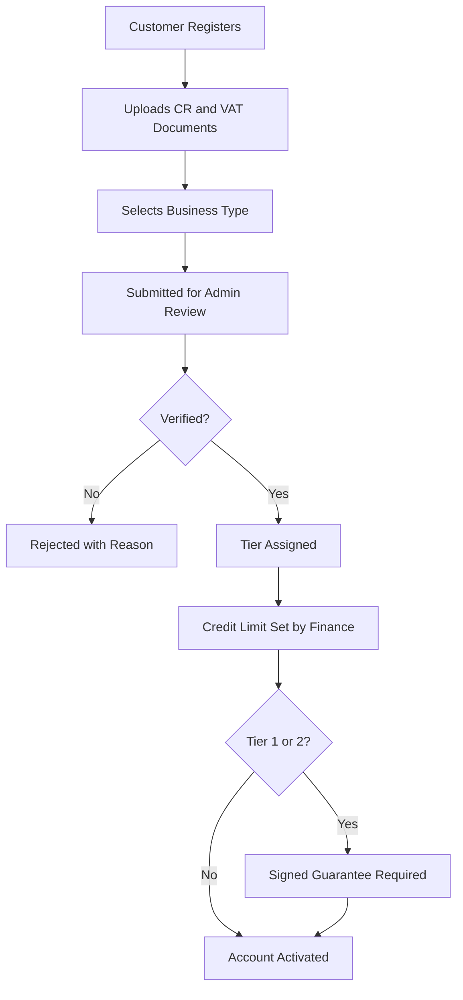
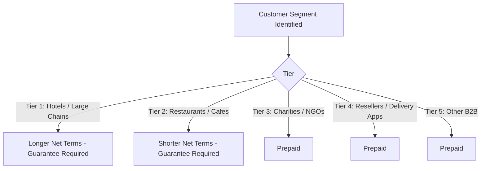
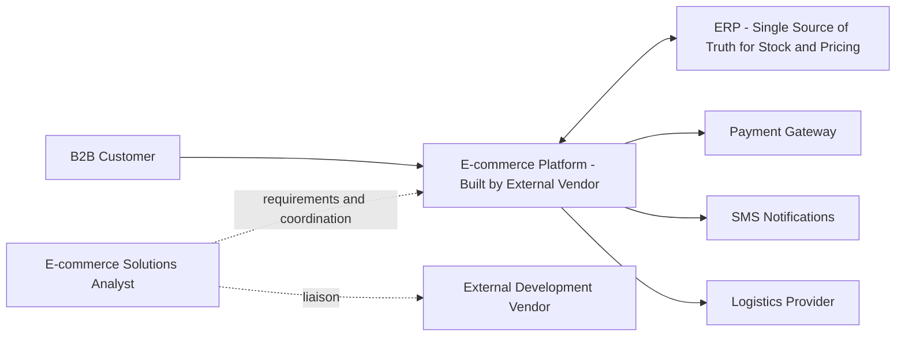
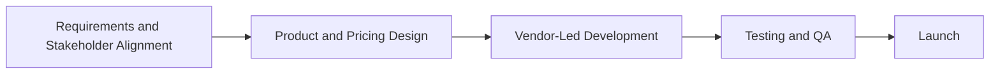
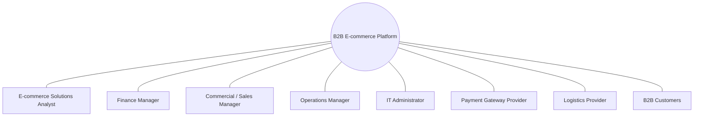

# B2B E-commerce Implementation

**Case study** · FMCG retailer and wholesaler, Saudi Arabia · Feb 2023 – May 2025 · Role: E-commerce Solutions Analyst

This is the full write-up behind the [README](../README.md). It covers why the channel was needed, what I designed, how I worked with the vendor, and how the platform was tested and launched. The formal requirements are in the [Business Requirements & Design Specification](BRD.md).

## Why the channel was needed

Wholesale ordering was physical only. A customer visited a branch, handed over a paper draft, waited for manual picking, and received an invoice adjusted by hand. There was no self-service and no way to order outside business hours. Once the ERP was live and its stock and prices could be trusted, the company decided to extend it into a digital ordering channel for business customers.

The main design constraint was clear from the start: verified B2B customers had to be able to order at any hour, without the platform keeping its own copy of stock or prices that could drift away from the ERP.

The goals were 24/7 ordering for verified accounts, less manual order handling, tiered pricing applied correctly to each customer segment, regional minimum order values, live stock accuracy between the platform and the ERP with no online overselling, ordering restricted to verified accounts, and credit terms built into the account structure.

**In scope:** 8,000+ active SKUs read live from the ERP, 5-tier customer segmentation and pricing, the ERP integration, a payment gateway (MADA, Visa, Mastercard, Apple Pay), regional delivery rules, a logistics tracking API, and the customer registration and verification workflow. A B2C-ready architecture was built but left inactive for a future decision.

**Out of scope:** activating B2C, a native mobile app, platform-side inventory, and AI-driven pricing.

## My role

I studied and scoped the channel before the project formally started, so I was part of the decision to build it. From early 2023 the platform was my main responsibility, and ERP work became secondary support.

An external vendor built the platform. I owned the business side: I ran workshops with the commercial, finance, and operations teams, designed the order lifecycle, pricing, and delivery rules, wrote the specifications the vendor built against, and reviewed what was delivered against them. I managed the backlog with the vendor in Jira, ordered it by how important each requirement was for the next release, logged defects with the vendor, and followed them up. I coordinated UAT, tested the platform myself, and took part in the Go/No-Go decision.

## What I designed

### Customer access

Only verified businesses can order, and nobody can register straight into an active account. A customer registers, uploads CR and VAT documents, selects a business type, and the application goes for review. A rejected application gets a reason. An approved account is assigned one of the 5 tiers, Finance sets the credit limit, and net-term tiers need a signed guarantee before activation.

### Pricing and credit

The tiers follow payment risk instead of a single wholesale discount.

| Tier | Segment | Terms |
|---|---|---|
| 1 | Hotels and large F&B chains | Longer net terms, signed guarantee required |
| 2 | Restaurants and cafes | Shorter net terms, signed guarantee required |
| 3 | Charities and NGOs | Prepaid |
| 4 | Resellers and delivery apps | Prepaid |
| 5 | Other B2B customers | Prepaid |

A net-term order that goes over the customer's credit limit is blocked at checkout. It is the same credit control the ERP already applied in the branches, used again in a new channel.

### Delivery

Delivery is priced by region, not at a flat national rate. The minimum order value, the delivery fee, and the free-delivery threshold differ across 4 regions, and the platform calculates them at checkout.

### Catalog and product content

The 8,000+ SKUs come live from the ERP, so any change to stock or price in the ERP shows on the platform immediately. Images, descriptions, and translations were not held in the ERP, so I coordinated a small team that maintained that content on the platform. Keeping it separate protected the ERP's role as the only source for stock and prices.

## Integrations

- **ERP:** live stock and price feed, with the ERP as the single source of truth.
- **Payment gateway:** MADA, Visa, Mastercard, and Apple Pay for prepaid tiers.
- **SMS:** customer notifications.
- **Logistics provider:** order tracking after confirmation.

I coordinated each integration with the vendor, and each was checked during testing.

## Testing and launch

I coordinated UAT with business users and tested the business processes and system behavior myself, instead of relying only on the vendor's QA. I was the main contact between the business, the vendor, and the internal technical team until issues were closed, and I took part in the Go/No-Go decision. The platform launched as a digital extension of the wholesale channel, open only to verified B2B accounts from the first day.

The chart shows the order of the stages only. No internal stage dates are documented beyond the project period.

## Customer onboarding

I sometimes joined customer conversations during account onboarding, including product walkthroughs and commercial discussions, alongside the commercial team. Negotiation and closing stayed with that team.

## Outcome

The platform replaced in-person wholesale ordering with self-service, improved stock synchronization between the platform and the ERP, and reduced manual order handling. It supported more than 500 B2B customers, with the 5-tier pricing model and 4 delivery regions in place. A set of post-launch KPI targets was drafted, but those were targets, not measured results, so they are not reported here.

| Aspect | Before | After |
|---|---|---|
| Ordering hours | Business hours only | 24/7 |
| Process | Branch visit and paper draft | Self-service ordering |
| Staff involvement | Needed for every order | Not needed per order |
| Order history | Not available to the customer | Available in the customer portal |

The platform depends on the ERP from the [Multi-Branch ERP Implementation](https://github.com/omaralburiki/Multi-Branch-ERP-Implementation).
